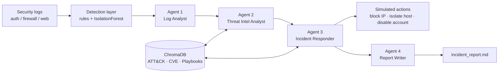

# Multi-Agent Cyber-Threat Detection and Response System Using CrewAI and RAG

[](https://colab.research.google.com/github/riverrover-stack/cyber-threat/blob/claude/dazzling-planck-e4gp9k/notebooks/Multi_Agent_Cyber_Threat_Detection.ipynb)


A Security-Operations-Center (SOC) style pipeline in which a **crew of cooperating LLM agents** (built with
[CrewAI](https://docs.crewai.com)) detects attacks in security logs, enriches them with **Retrieval-Augmented
Generation (RAG)** over a MITRE ATT&CK / CVE / playbook knowledge base, executes (simulated) containment, and writes an
incident report.

## Table of Contents
1. [Features](#features) · 2. [Architecture](#architecture) · 3. [Quick start](#quick-start) · 4. [Configuration](#configuration)
5. [Project structure](#project-structure) · 6. [Results](#results) · 7. [Testing](#testing) · 8. [Documentation](#documentation)
9. [Limitations](#limitations) · 10. [Future work](#future-work) · 11. [License](#license)

## Features
- **Synthetic labelled telemetry** (auth, firewall, web) with six injected attacks: SSH brute force, port scan, SQL injection,
  C2 beaconing, data exfiltration, privilege escalation.
- **Hybrid detection**: signature/threshold rules + `IsolationForest` anomaly detection.
- **RAG knowledge base** in ChromaDB: MITRE ATT&CK techniques, CVE samples, IR playbooks (sentence-transformers embeddings,
  automatic TF-IDF fallback when the model cannot be downloaded).
- **Four CrewAI agents** with custom tools: Log Analyst, Threat Intelligence Analyst, Incident Responder, Report Writer.
- **Free LLMs**: Groq (`llama-3.3-70b-versatile`) or Google Gemini (`gemini-2.0-flash`) through CrewAI/LiteLLM.
- **Offline mode**: with no API key the same tools + RAG run deterministically, so the notebook always executes end-to-end.
- **Safe by design**: response actions are *simulated* and restricted to an allow-list.
- **Evaluation**: precision / recall / F1, per-attack recall, RAG hit-rate@k, plots.

## Architecture

See [docs/ARCHITECTURE.md](docs/ARCHITECTURE.md) for details.

## Quick start

### Google Colab
The notebook is **self-contained** (code and knowledge base are embedded; no repo clone needed).
1. Upload `notebooks/Multi_Agent_Cyber_Threat_Detection.ipynb` to <https://colab.research.google.com> (File → Upload notebook),
   or use the **Open in Colab** badge if the repository is public.
2. *(Optional, for the live LLM crew)* add a Colab secret `GEMINI_API_KEY` (free at <https://aistudio.google.com>) or
   `GROQ_API_KEY` (free at <https://console.groq.com>) and switch on *Notebook access*. The provider is auto-detected.
3. To use a specific model (e.g. Gemma), set `os.environ["GEMINI_MODEL"] = "gemini/<model-id>"` in the config cell; the
   notebook can list the model IDs your key supports.
4. **Runtime → Run all.** Without a key (or if the live crew fails) the notebook runs in offline mode.

### Local Jupyter
```bash
git clone https://github.com/riverrover-stack/cyber-threat.git && cd cyber-threat
python -m venv .venv && source .venv/bin/activate
pip install -r requirements.txt jupyter
cp .env.example .env            # add GROQ_API_KEY or GEMINI_API_KEY (optional)
jupyter notebook notebooks/Multi_Agent_Cyber_Threat_Detection.ipynb
```

### As a library
```python
from cyberthreat import crew
crew.setup_context()          # generate logs + build the ChromaDB knowledge base
result = crew.run_pipeline()  # CrewAI crew if a key is set, otherwise offline mode
print(result["report"])
```

## Configuration
| Variable | Purpose | Default |
|---|---|---|
| `LLM_PROVIDER` | `groq`, `gemini` or `offline` | unset = auto-detect from whichever API key exists; `offline` without a key |
| `GROQ_API_KEY` / `GEMINI_API_KEY` | Free-tier API keys | – |
| `GROQ_MODEL` / `GEMINI_MODEL` | Model override, `provider/<model-id>` (works for Gemma on AI Studio) | `groq/llama-3.3-70b-versatile` / `gemini/gemini-2.0-flash` |

Keys are read from the environment, a `.env` file, or Colab secrets. **Never commit keys** (`.env` is git-ignored).

## Project structure
```
├── notebooks/Multi_Agent_Cyber_Threat_Detection.ipynb   # self-contained notebook (generated)
├── scripts/build_standalone_notebook.py                 # regenerates the notebook from src/ + knowledge_base/
├── src/cyberthreat/   config · data_generator · detection · rag · tools · agents · tasks · crew · evaluation
├── knowledge_base/    mitre_attack_techniques.json · cve_samples.json · ioc_feed.json · playbooks/*.md
├── docs/              ARCHITECTURE · AGENTS_AND_TOOLS · RAG_PIPELINE · USER_GUIDE · EVALUATION · PROJECT_REPORT
├── tests/             detection · RAG · offline pipeline
└── outputs/           generated incident_report.md, action_log.json, figures
```

## Results
Results from the executed notebook (offline mode, seed 42) are recorded in [docs/EVALUATION.md](docs/EVALUATION.md)
and in the notebook outputs. 

| Configuration (synthetic data, seed 42) | Precision | Recall | F1 |
|---|---|---|---|
| Rules only | 1.00 | 1.00 | 1.00 |
| Rules + IsolationForest | 0.93 | 1.00 | 0.96 |

All six injected incidents were detected and typed correctly; RAG hit-rate@3 is 0.88 on 8 test queries (TF-IDF fallback
embeddings). Rule thresholds were designed alongside the generator, so the perfect rule score reflects a controlled
benchmark, not real-world performance - see [Limitations](#limitations).

## Testing
```bash
pip install -r requirements.txt
pytest -q
```

## Documentation
| Document | Contents |
|---|---|
| [Architecture](docs/ARCHITECTURE.md) | Components, data flow, design decisions |
| [Agents & Tools](docs/AGENTS_AND_TOOLS.md) | Roles, goals, tools, tasks |
| [RAG Pipeline](docs/RAG_PIPELINE.md) | Corpus, chunking, embeddings, retrieval |
| [User Guide](docs/USER_GUIDE.md) | Colab/Jupyter setup, API keys, troubleshooting |
| [Evaluation](docs/EVALUATION.md) | Metrics, methodology, results |
| [Project Report](docs/PROJECT_REPORT.md) | Abstract, objectives, methodology, conclusion, references |
| [Contributing](CONTRIBUTING.md) · [Changelog](CHANGELOG.md) | |

## Limitations
- Logs are synthetic; detection thresholds are tuned to them and real traffic will need re-tuning.
- Benign periodic traffic (e.g. monitoring agents) may resemble beaconing.
- The knowledge base is a small curated subset, not the full ATT&CK / NVD corpora.
- Response actions are simulated; integration with real firewalls/EDR is out of scope.
- LLM output is non-deterministic; free-tier models are rate limited (the crew is throttled with `max_rpm`).

## Future work
Real datasets (CICIDS2017, Zeek/Suricata logs), full ATT&CK STIX ingestion, hybrid BM25 + dense retrieval, SIEM/SOAR
integration with human-in-the-loop approval, streaming detection, and an LLM-as-judge evaluation of report quality.

## License
MIT - see [LICENSE](LICENSE).
