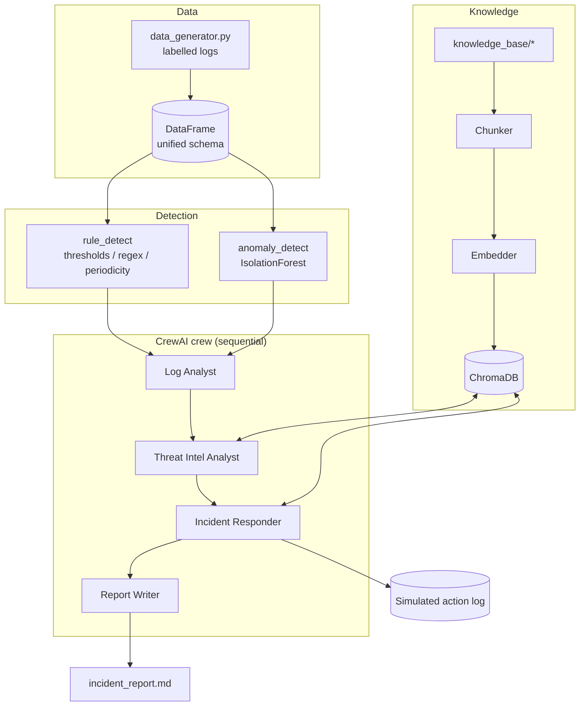

# Architecture

## Overview
The system is a four-stage pipeline orchestrated by CrewAI. A deterministic detection layer produces alerts; agents
enrich and respond to them using a shared RAG knowledge base; a final agent writes the report.

## Components
| Module | Responsibility |
|---|---|
| `config.py` | Paths, `.env`/Colab-secret loading, LLM provider selection, offline fallback |
| `data_generator.py` | Benign noise + one injected incident per attack type, with ground-truth labels |
| `detection.py` | `Alert` dataclass, rule detectors, IsolationForest, MITRE/severity maps |
| `rag.py` | Chunking, `Embedder`, ChromaDB `KnowledgeBase`, hit-rate metric |
| `tools.py` | Plain tool functions + CrewAI `BaseTool` wrappers sharing a `SecurityContext` |
| `agents.py` / `tasks.py` | Agent roles and the sequential task chain |
| `crew.py` | `build_crew`, `run_pipeline`, deterministic `run_offline`, report builder |
| `evaluation.py` | Metrics, per-attack report, plots |

## Key design decisions
1. **Detection is deterministic, reasoning is agentic.** Rules/ML find events cheaply and reproducibly; LLM agents
   spend tokens only on enrichment, response planning and communication.
2. **One code path for tools.** The CrewAI tools and the offline pipeline call the same functions, so offline mode
   exercises the real logic and tests need no API key.
3. **Offline fallback.** No key -> `LLMSettings.offline` -> `run_offline()`. The notebook therefore always runs.
4. **Safety.** `ResponseActionTool` only records actions, validates them against an allow-list and de-duplicates.
   Low-confidence anomaly alerts only open a ticket, never trigger containment.
5. **Embedding fallback.** `Embedder` uses `all-MiniLM-L6-v2` when it can load, otherwise a hashing TF-IDF vectoriser.
   Embeddings are computed outside Chroma and passed in, which keeps the code independent of Chroma's embedding API.
6. **Free-tier friendliness.** Tool outputs are compact JSON/text and the crew is throttled (`max_rpm=20`).

## Data flow of a single incident (SSH brute force)
`rule_detect` -> alert (`threat_ip` = attacker) -> Intel agent searches ATT&CK (T1110) and checks the IOC feed ->
Responder retrieves the *SSH Brute Force* playbook, reads its Containment steps -> `block_ip(attacker)` and
`disable_account(compromised user)` -> Report Writer summarises.
